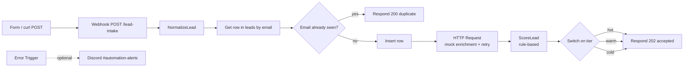

# Northwind Lead Router (n8n inbound lead intake)

**Public showcase.** A consented lead comes in through a webhook, gets normalized and de-duplicated, is enriched, then receives a **rule-based** score and is routed as hot, warm, or cold.

Fictional company: **Northwind Solar Co-op**, a residential solar installer. All data is sample data (`example.com` emails). This is the companion automation to [support-ops-agent](https://github.com/latin-guru/support-ops-agent).

Built in **n8n**: Webhook → NormalizeLead → Data Table dedupe → Insert → HTTP mock enrichment → ScoreLead → Switch (hot / warm / cold) → Respond.

> Status: Intake, dedupe, enrichment, scoring and routing are complete (the live build accepted new leads and scored a sample "get a quote" lead at 100 / hot). A separate error-alert workflow is the same pattern as `Northwind Error Alerts` in the support-ops-agent repo; hook that workflow in Settings → Error Workflow after import.

## Architecture



## What each step does

1. **Webhook** accepts JSON: `email`, `firstName`, `company`, `phone`, `formIntent`. Responds with a **Respond to Webhook** node (not "immediately"), so the caller gets a real status body.
2. **NormalizeLead** lowercases and trims the email and copies the other fields, plus a `receivedAt` timestamp.
3. **Get row(s)** looks up that email in the `leads` Data Table.
4. **If** the email already exists → **Respond 200** `{ "status": "duplicate", "email": "..." }` and stop. That keeps the table idempotent: the same lead posted twice does not create a second row.
5. **Insert row** stores the new lead (`status: new`). The phone column is written as text so values like `(555) 333-4444` are accepted.
6. **HTTP Request** calls a public mock enrichment API (`https://jsonplaceholder.typicode.com/users/1`) so the next step has a company name to work with. In the live build, Retry On Fail was turned on (3 tries, 2s wait).
7. **ScoreLead** applies documented rules (below) and sets `score` plus `tier`.
8. **Switch** branches on `hot` / `warm` / `cold`. All three branches return **202** `{ "status": "accepted", "email", "score", "tier" }`.

Hot / warm / cold branches are ready for later actions (Discord `#hot-leads`, a nurture table, a review table) without changing the scoring.

## Scoring rules (rule-based, not an ML model)

| Rule | Points |
|---|---|
| `formIntent` contains "quote" (case-insensitive) | +40 |
| A phone number is present | +25 |
| Enrichment returned a company name longer than 3 characters | +20 |
| An email is present | +15 |

| Total | Tier |
|---|---|
| 70 or more | hot |
| 40–69 | warm |
| under 40 | cold |

Example from the live build: `Maria.Lopez@Example.com`, phone present, `formIntent: "get a quote"`, enrichment company `Romaguera-Crona` → **score 100 / tier hot**.

A second post of the same email returns `{ "status": "duplicate" }` and does not insert again.

## Sample requests

Replace `YOUR_N8N_HOST` with your n8n instance. Use the **Listen for test event** URL while you are building (`/webhook-test/lead-intake`), then the production URL (`/webhook/lead-intake`) after you publish the workflow.

New lead (should accept and score hot):

```bash
curl -X POST 'https://YOUR_N8N_HOST/webhook-test/lead-intake' \
  -H 'Content-Type: application/json' \
  -d '{"email":"Maria.Lopez@Example.com","firstName":"Maria","company":"Summit Panels Inc","phone":"(555) 777-8888","formIntent":"get a quote"}'
```

Same email again (should return duplicate):

```bash
curl -X POST 'https://YOUR_N8N_HOST/webhook-test/lead-intake' \
  -H 'Content-Type: application/json' \
  -d '{"email":"Maria.Lopez@Example.com","firstName":"Maria","company":"Summit Panels Inc","phone":"(555) 777-8888","formIntent":"get a quote"}'
```

A weaker intent, for a warm or cold path:

```bash
curl -X POST 'https://YOUR_N8N_HOST/webhook-test/lead-intake' \
  -H 'Content-Type: application/json' \
  -d '{"email":"sam.review@example.com","firstName":"Sam","company":"","phone":"","formIntent":"just browsing"}'
```

## Setup

1. In n8n, create a Data Table named `leads` with text columns: `email`, `firstName`, `company`, `phone`, `formIntent`, `receivedAt`, `status`. Keep `phone` as text, not a number.
2. Import `workflows/northwind-lead-router.json`.
3. Open both Data Table nodes (**Get row(s)** and **Insert row**) and re-select the `leads` table (values marked `REPLACE_AFTER_IMPORT` on purpose).
4. Optional: turn on **Retry On Fail** on the HTTP Request node (3 tries, 2000 ms) if it is not already set.
5. Optional reliability: import `Northwind Error Alerts` from [support-ops-agent](https://github.com/latin-guru/support-ops-agent), publish it, and set it as this workflow's **Error Workflow**. Then temporarily break the enrichment URL, post a new sample email, and confirm an alert lands in `#automation-alerts`.
6. Listen for a test event, run one of the curl commands above, and confirm the response body.

The exported workflow was cleaned with `scripts/sanitize_workflow.py`: instance ID, workflow ID, webhook IDs/paths, project IDs and data-table IDs are removed.

## Honest limits / what I'd do next

- **Mock enrichment.** The HTTP call uses a public placeholder API, not a real company database. Production would use a real enrichment provider, with the same retry and error-workflow pattern.
- **Routing actions.** The Switch branches exist; they currently all return the same 202 body. Next step is a formatted Discord (or Slack) message for hot leads, a nurture table for warm, and a review table for cold, plus optional round-robin assignment to fake reps.
- **Error workflow.** Designed and used on the companion support agent; wiring it to this router and capturing a broken-enrichment screenshot is the remaining packaging step.
- **Validation.** Missing required fields are not yet rejected with a 400 / dead-letter row.
- **Sample scale.** Built on an n8n Cloud trial with a small Data Table of test leads.

## Contact
[LinkedIn: Kevin Gaviria](https://www.linkedin.com/in/kevin-gaviria)
